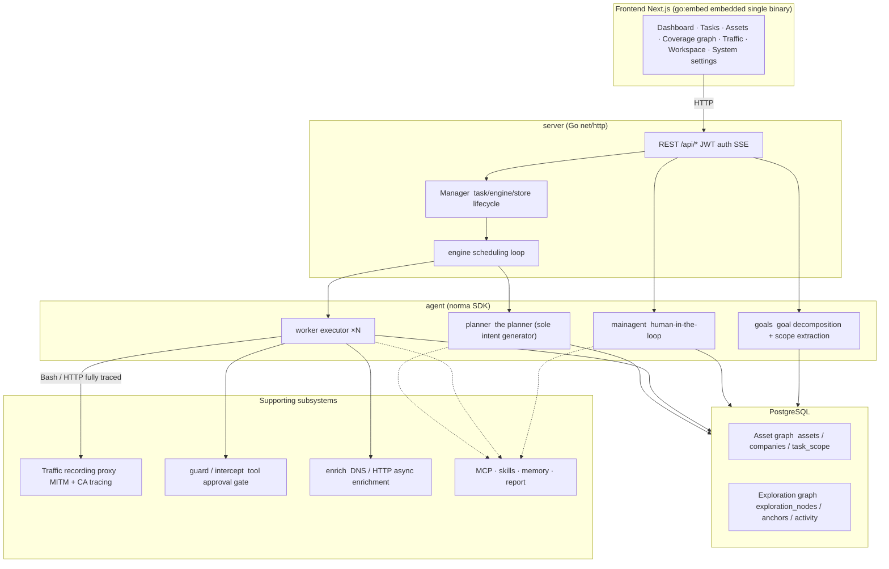
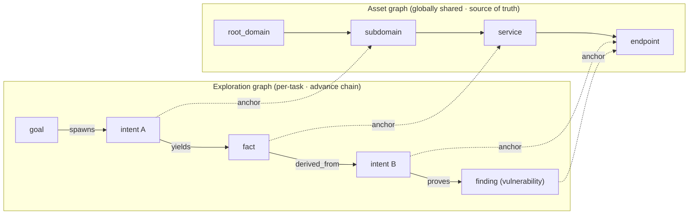
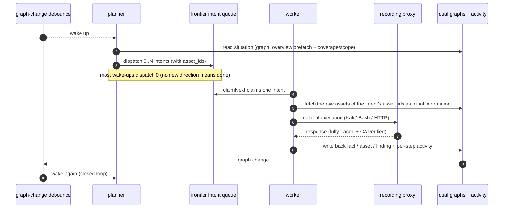
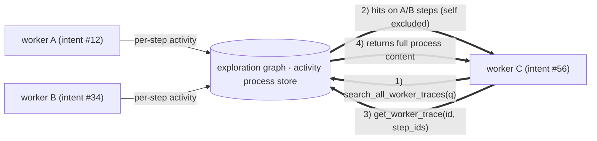
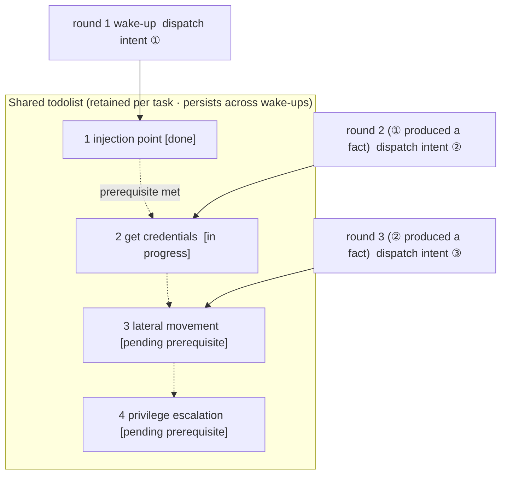

<div align="center">

# ARTEX

AI autonomous penetration testing system (Go backend + Next.js frontend)


 Fork of [ARTEX by Autumn-27](https://github.com/Autumn-27) · English translation of the Chinese source · maintained publicly under AGPL-3.0

</div>

---

## Screenshots


| Dashboard (overview / token usage / activity stream) | Task list |
| :---: | :---: |
|  |  |

| Task · execution (sessions / tool calls) | Exploration graph |
| :---: | :---: |
|  |  |

| Findings | Assets |
| :---: | :---: |
|  |  |

| Asset coverage graph (force-directed layout · tested highlights · node collapse/expand) |
| :---: |
|  |

| Traffic recording | Human-in-the-loop chat |
| :---: | :---: |
|  |  |

| Agent management | LLM configuration |
| :---: | :---: |
|  |  |

| Interception approvals | Backend logs |
| :---: | :---: |
|  |  |


---

## Approval record details

The global "Approval Records", the in-task "Interception Approvals", and the approval cards in conversations all support expanding to view details. The display structure references the
[AegisHook approval details component](https://github.com/RuoJi6/AegisHook/blob/main/web/src/components/CallDetail.vue), reusing ARTEX's components and theme:


## Traffic capture browser extension

The bundled browser extension (`extension/`) turns your own browsing into agent-visible evidence: log into an authenticated target once (captchas, email OTP and 2FA included), and the captured requests/responses land in ARTEX's traffic store like proxy-recorded traffic, ready to search and bind to findings:

- Load the unpacked extension from `extension/` (Chrome/Edge, Developer Mode → Load unpacked);
- In the popup, set your ARTEX URL and token, then press **Start capture** on the tab you are browsing;
- Use the site normally; text requests/responses are batched to `POST /api/traffic/ingest` (authenticated). Binary bodies (images, fonts) are skipped, bodies are truncated at 256 KiB, batches are capped at 50 entries;
- Press **Stop** when done. Everything stays in your local traffic store.

## Asset sync (ScopeSentry)

Sync asset data directly from [ScopeSentry](https://github.com/Autumn-27/ScopeSentry), avoiding duplicate collection:

- On the "**Asset Sync**" page, enter the ScopeSentry address and API Key to connect the data source;
- Choose the targets and asset types to sync by **project** or **task** (domains / subdomains / IPs / ports / sites / endpoints…);
- One-click import, merged by company asset scope, straight into ARTEX's asset graph for agents to explore.

---

## Installation

> Requires a **PostgreSQL** database; exploration requires an **LLM** (`ANTHROPIC_API_KEY` or `OPENAI_API_KEY`, which can also be configured in the UI).

### Option 1: one-click install script (recommended)

```bash
git clone https://github.com/BaaRai/ARTEX.git
cd ARTEX
./install.sh
```

The script will: detect / auto-install Docker → then let you choose **① all-Docker** or **② local build and run**:

- **① All-Docker**: enter a Postgres password (press Enter for a random one) → auto-writes `.env` → `docker compose up -d --build`.
- **② Local run**: choose a database (connect to an existing one / start one with Docker) → generates `config.json` → `go` builds the embedded single binary → starts.

Once installed, open **http://localhost:8787** (on first entry, `/setup` sets the admin password).

### Option 2: Docker Compose (manual)

```bash
git clone https://github.com/BaaRai/ARTEX.git
cd ARTEX
cp .env.example .env          # set POSTGRES_PASSWORD, optionally ANTHROPIC_API_KEY
docker compose up -d --build  # builds the artex image from source + starts postgres
# → http://localhost:8787
```

The image is built locally and already includes common tools (ripgrep/curl/vim/npm/nmap…); `./skills` and `./data` are persisted via bind mounts.

A multi-arch image is also published to `ghcr.io/baarai/artex`. To use it instead of building, replace the `build:` block in `docker-compose.yml` with `image: ghcr.io/baarai/artex:latest` and run `docker compose pull`.

For remote MCP, you can choose `http` (Streamable HTTP) or `sse` (legacy SSE) in system settings.
Legacy SSE servers usually establish the event stream with `GET /sse`, then receive JSON-RPC requests via the
`/message?sessionId=...` returned by the server; when configuring, set the URL to `/sse` and the request header as
`Authorization=Bearer <token>`.

### Option 3: download prebuilt binaries (Releases)

Download the zip for your platform from [Releases](https://github.com/BaaRai/ARTEX/releases); after extracting you get `artex` + `start.sh` (`start.bat` on Windows) + `skills/` + `config.example.json`:

```bash
cp config.example.json config.json   # fill in the database connection
./start.sh                           # → http://localhost:8787
```

> Please start with `start.sh` / `start.bat` instead of running `./artex` directly. It is a daemon script: if the process crashes, it restarts it after a backoff.
> To keep it running in the background: `nohup ./start.sh >artex.log 2>&1 &`.

### Option 4: build the single binary from source

```bash
# 1) frontend static export
cd web && npm ci && npm run build:static && cd ..
# 2) copy into the embed directory
cp -r web/out server/webui/dist
# 3) build (only -tags embedui embeds the frontend)
CGO_ENABLED=0 go build -tags embedui -o artex ./cmd/artex
./start.sh
```

### Option 5: build cross-platform release archives

`build.sh` first builds and embeds the frontend, then strips debug info via the Go linker, and compresses the release files into zips. Release mode generates zips for Linux amd64/arm64, macOS amd64/arm64, and Windows amd64 by default:

```bash
./build.sh --release
# output: dist/artex-0.3.3-*.zip
```

UPX self-extracting binaries may be incompatible with some Linux kernels, virtualization environments, or security policies, so they are disabled by default. Use `ARTEX_TARGETS` to customize the targets; when you have confirmed the target runtime is compatible, explicitly pass `--upx` to further shrink the binary:

```bash
ARTEX_TARGETS=linux/amd64,windows/amd64 ./build.sh --release
./build.sh --target linux/amd64 --upx
```

---

## Backups

`scripts/backup.sh` dumps the Postgres database (and optionally the data
directory) with timestamped output and rotation:

```bash
scripts/backup.sh --with-data          # db dump + data/ archive, keep 14
scripts/backup.sh --keep 7             # db only, keep 7
```

Restore a dump into a running stack:

```bash
gunzip -c backups/artex-db-<timestamp>.sql.gz | docker compose exec -T postgres \
  psql -U "$POSTGRES_USER" -d "$POSTGRES_DB"
```

Daily cron example (03:20, operator crontab):

```
20 3 * * * cd /path/to/ARTEX && scripts/backup.sh --with-data >> backups/backup.log 2>&1
```

## Updating and upgrading

> Upgrading only swaps the program and never touches data: the Postgres volume `pgdata`, `./data` (jwt.key / SQLite, etc.), and `./skills` are all preserved. **No manual database migration is needed**: `artex` idempotently re-runs `schema.sql` on every start (with `ADD COLUMN` / `CREATE INDEX IF NOT EXISTS`), i.e. "restart equals migrate". It is still recommended to back up `./data` and the database before upgrading.

### Option 1: one-click update script

```bash
cd ARTEX
./update.sh
```

The script first optionally `git pull`s the latest code, then lets you choose **① Docker update** or **② local build update** (matching `install.sh`):

- **① Docker**: rebuild the image from the pulled source (`docker compose build --pull artex`) → `docker compose up -d artex` (restarting with the new image migrates automatically).
- **② Local**: rebuild the frontend static assets → recompile `./artex` (restart the process for it to take effect).

### Option 2: Docker Compose (manual)

```bash
cd ARTEX
git pull                       # update the source
docker compose build --pull artex
docker compose up -d artex     # restart with the new image → schema migrates automatically
docker image prune -f          # clean up old images (optional)
```

### Option 3: prebuilt binaries (Releases)

Download the new version's zip from [Releases](https://github.com/BaaRai/ARTEX/releases), stop the old process, then overwrite `artex` and `skills/` (keep your `config.json` and `data/`), and restart:

```bash
cp -r <extracted dir>/skills ./ && cp <extracted dir>/artex ./
./start.sh
```

### Option 4: build from source

```bash
git pull
cd web && npm ci && npm run build:static && cd ..
cp -r web/out server/webui/dist
CGO_ENABLED=0 go build -tags embedui -o artex ./cmd/artex
# restart ./start.sh
```

---

## Configuration

**Database** (`config.json`, or override with the `ARTEX_PG_DSN` environment variable):

```json
{
  "database": {
    "host": "127.0.0.1", "port": 5432,
    "user": "artex", "password": "yourpass",
    "dbname": "artex", "sslmode": "disable"
  }
}
```

**LLM**: `export ANTHROPIC_API_KEY=sk-...` (or `OPENAI_API_KEY`); you can also fill it in on the UI's "LLM Configuration" page — which can add a local Ollama server as a keyless provider (format "Ollama", base URL default `http://127.0.0.1:11434/v1`, models loaded from the server).
Optional: `ARTEX_LLM_PROVIDER` (anthropic | openai | openai-responses | ollama) / `ARTEX_LLM_MODEL` / `ARTEX_LLM_BASE_URL` / `ARTEX_LLM_PROXY`.

**Concurrency**: the number of work agents per task is configured in "System Settings" (default 3).

**Common flags**: `./start.sh -addr :8787 -proxy :8788` (`-addr` frontend+API, `-proxy` traffic recording proxy). The startup script passes arguments through to `artex` verbatim.

### Reverse proxy deployment (HTTPS / only exposing 443)

The frontend and API/SSE are served by the same backend port (default `:8787`), and the realtime activity stream uses the **same-origin** address by default, so **there is no need to configure `NEXT_PUBLIC_SSE_BASE`**: just expose 443 publicly and keep 8787 on the internal network.

SSE is a long-lived connection with continuous pushes, so the reverse proxy **must disable buffering**, otherwise the browser connects but never receives events (the activity stream spins forever). Nginx example:

```nginx
server {
    listen 443 ssl;
    server_name your.domain.com;
    # ssl_certificate / ssl_certificate_key ...

    location / {
        proxy_pass http://127.0.0.1:8787;
        proxy_set_header Host $host;
        proxy_set_header X-Forwarded-Proto $scheme;

        # SSE essentials: buffering off, long timeouts, HTTP/1.1
        proxy_buffering off;
        proxy_cache off;
        proxy_read_timeout 3600s;
        proxy_http_version 1.1;
        proxy_set_header Connection "";
    }
}
```

> Only when SSE needs a different origin from the page (e.g. a dedicated subdomain) should you set `NEXT_PUBLIC_SSE_BASE` **at build time** (this variable is baked into the static bundle during `next build`; setting it at container runtime has no effect).

---


## Development

### Manual vulnerability retesting

The "Retest" tab on the task details page lets you page through the task's vulnerabilities, review past conclusions and evidence, and manually start a retest. After starting, the current tab keeps its place and shows a spinner with "Retesting"; once the fix is confirmed, the vulnerability status is updated accordingly.

Click "Retest" in the actions area of any row in the vulnerability list, or click "Start Retest" in the "Vulnerability Retest" area of the vulnerability details; fill in the optional fixed version, test conditions, or limits, and the system creates an independent retest agent session while keeping the current page. The flat list, group-by-task, and asset views all support this entry point; while a retest is running, a spinner and "Retesting" are shown: click to enter the corresponding session to watch, and it reverts to "Retest" when finished. Retesting does not require restarting the original scan task; conclusions are "Still reproducible", "Fixed", or "Cannot confirm", and each conclusion, evidence, and session link is saved in the vulnerability details.

On first start, the new backend pre-creates an editable "Vulnerability Retest" (`retester`) agent; you can configure its prompt, LLM, run budget, and tools in Agent management. It uses its bound LLM by default, or the global active configuration when unbound. When a retest session completes successfully with a "Fixed" conclusion, the system automatically sets the vulnerability's handling status to "Fixed"; running, failed, stopped, or other conclusions keep the original status. Original evidence and reports are always preserved. You can also manually select "Fixed" from the status dropdown. While the same vulnerability is being retested, the existing session is reused; after a stop, failure, or service restart, you can start it again.

In this version, history is viewed via vulnerability details and sessions; it is not yet included in vulnerability report exports or task archive packages, and is not automatically linked to traffic captures. Demo mode only generates clearly labeled simulated records and never requests real targets.

### Running and testing locally

```bash
./dev.sh    # backend(:8787) + traffic proxy(:8788) + frontend next dev(:5173) → http://localhost:5173
```

- Backend: `go run ./cmd/artex` (without `-tags embedui`, the frontend is not embedded)
- Frontend: `cd web && npm run dev` (`/api` is reverse-proxied to the backend, with hot reload)
- Tests: `go test ./...`
- Mock preview (no backend): `cd web && NEXT_PUBLIC_MOCK=1 npm run dev`

---

## System architecture

ARTEX is an **LLM multi-agent-driven autonomous penetration testing system**: a Go monolithic backend (with embedded Next.js frontend) + PostgreSQL; agent capabilities are provided by the [`norma`](https://github.com/Autumn-27/norma) SDK (`agentcore` / `tool` / `permission` / `harness` / `memory` / `transcript`). At its core is a **dual-graph architecture**, plus two autonomy mechanisms built around it: **process-level information exchange between workers** and the **planner's multi-round shared todolist that stabilizes attack chains**.

### Overall layering



| Layer | Responsibility |
| --- | --- |
| **Frontend** | Next.js static export, embedded into the single binary via `go:embed`; visualizes tasks/assets/exploration graph/coverage graph, human-in-the-loop chat |
| **server** | `net/http` routing + JWT auth + SSE; `Manager` owns the lifecycle of tasks, engines, and DB stores |
| **engine** | One `plannerLoop` + N worker goroutines per task; intent claiming, timeout/pause/drain |
| **agent** | goals / planner / worker / mainagent; `ToolSet` exposes the dual graphs as LLM tools |
| **db** | Postgres persistence of the dual graphs (pgx); the schema is embedded via `go:embed` and idempotently applied on every start |
| **Supporting** | Recording MITM proxy, approval gate, async enrichment, MCP/skills/memory/report |

### Dual-graph architecture: exploration graph + asset graph

The system splits "**what the goals are**" and "**how far testing has progressed**" into two mutually independent graphs linked by anchors:

- **Asset Graph (globally shared)**: a single source of truth for assets shared across tasks. Nodes are `root_domain / subdomain / ip / service / app / endpoint`, owned by companies; the parent-child relationships domain→subdomain→service→endpoint and the dedup keys are all computed by the program: agents only submit raw information.
- **Exploration Graph (per-task)**: the "thinking and advancing" process of one task. Nodes are `goal` / `intent` / `fact` / `finding (vulnerability)` / `hint`, connected by edges like `spawns / derived_from / yields / proves` into a **lineage chain**, answering "which directions derive from which facts, and what they produced".
- **The two graphs are linked by anchors**: `exploration_anchors(node_id, asset_id)` anchors intents/facts/vulnerabilities to concrete assets: so you can see which assets an exploration direction hits, and conversely look up from a given asset which intents tested it in this task and which facts were derived. This also powers **asset test coverage** and the **asset coverage graph** (in-scope assets + tested highlights).



> Division of labor: the **planner** reads the exploration graph's situation, judges goals, and dispatches **intents** into the frontier only when there are uncovered new directions; a **worker** claims **one intent**, executes with real tools, writes new assets/facts/vulnerabilities back into both graphs, then stops. The asset graph is shared facts; the exploration graph is the per-task advance chain.

### Engine and intent lifecycle (the closed loop of one exploration)

The engine is an **event-driven** closed loop: any graph change wakes the planner, the planner dispatches intents, workers claim and execute intents and write back, and the write-back triggers the next round, until the goal is proven (`prove_goal`).



### Process-level information exchange between workers

During a deep exploration, many valuable observations (an error, a response snippet, a hidden parameter) appear in a worker's **execution process** but may never be written as formal facts. To avoid duplicate work and let workers on the chain stand on each other's shoulders, workers can **search processes across works**:

- `search_all_worker_traces(q)`: keyword-search the **execution processes of other works in this task** (automatically excluding the steps of your own intent); hits carry `intent_id`;
- `list_worker_traces` / `get_worker_trace(intent_id, step_ids=[…])`: first see which works have run, then fetch the full content of specific steps of a given work for detailed exchange.

This way, even before a corresponding fact exists on the exploration graph, later workers can reuse observations from others' processes: **information flows between workers at "execution process" granularity**, while the boundary stays the same (each worker still only works on the intent it claimed).



### The planner's multi-round shared todolist → stable attack chains

Real attack chains are usually **multi-step sequences with dependencies** (e.g.: find an injection point → obtain credentials → move laterally → escalate privileges); dispatching them all in parallel at once would only cause chaos. The planner therefore keeps a **planning todolist that is retained per task and shared across wake-ups**:

- The planner is event-driven, woken on every graph change, but **each wake-up is a brand-new session**; the shared todolist lets it **record a serial exploitation chain once**, then **dispatch intents step by step by dependency** over subsequent rounds, instead of pre-expanding the whole chain in a single round;
- Each round only dispatches intents for next steps whose "prerequisite steps are complete and the facts they depend on exist", and updates the list as progress happens (marking steps satisfied by facts as done).



Thus, even in an "event-driven + stateless session" environment, the attack chain still **advances steadily, without repetition or reordering**: this is the key to ARTEX autonomously completing multi-step exploitation chains.

---

## References

https://github.com/oritera/Cairn


## License and disclaimer

### Open source license

This project is licensed under the **GNU Affero General Public License v3.0 (AGPL-3.0)**; see the [LICENSE](LICENSE) file in the repository root for the full terms.

This means anyone may freely use, modify, and distribute this project, but **derivative works must also be open-sourced under AGPL-3.0**; in particular, **if you modify this project and provide it to users over a network (e.g. deployed as an online service), you must also make the corresponding complete source code available to those users**.

> ⚠️ **Important**: the open source license itself does not restrict how the software is used. The "Usage restrictions" and "Disclaimer" below are additional terms and a solemn statement from the maintainers to users, so please abide by them.

**ARTEX is an offensive-security tool. Use it only against systems you own, or that you are explicitly authorized to test (your own lab, your organization's assets, or a bug bounty / vulnerability disclosure program's targets within its published scope and rules of engagement). Any use without authorization is a violation of these terms.**

### Permitted use

- **Read, learn, and study this project's source code**;
- Run it against **systems you own** or in **isolated lab environments**;
- Run it against **authorized bug bounty / vulnerability disclosure program targets**, within their published scope and rules of engagement;
- Academic research and code review.

### Prohibited actions

- **It is strictly forbidden to scan, probe, exploit, or attack any website, online service, or networked system without the explicit authorization of its owner**;
- It is strictly forbidden to test outside a program's published scope, or in violation of its rules of engagement;
- It is strictly forbidden to use this tool for illegal intrusion, data theft, extortion, denial of service, or any destructive or criminal activity;
- It is strictly forbidden to use this tool for anything that violates the laws and regulations of your country/region.

### Compliance responsibility

Users must comply with all laws and regulations of their country/region regarding cybersecurity, data protection, and computer crime. **All legal liability and consequences arising from the use of this tool are borne by the user.**

### Disclaimer

This project is provided "as is", without any express or implied warranty. The authors and contributors are not liable for any direct or indirect loss, data loss, system damage, or legal disputes caused by the use of this tool (whether used properly or not). **Downloading, installing, or using this project means you have read, understood, and agreed to all of the above terms.**
