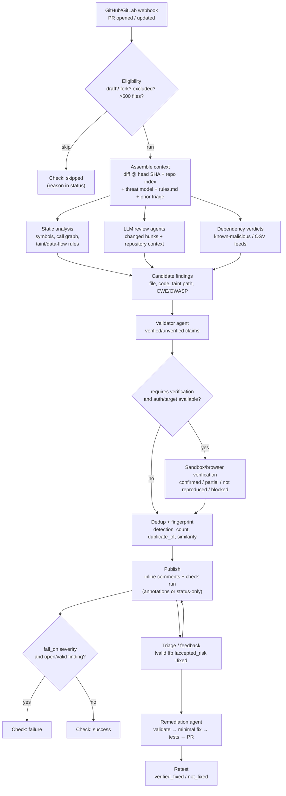

# AI PR Review: REA Analysis and ARTEX Integration Plan

Status: research + design. No source code, prompts, or proprietary assets from the reference product are reproduced here. The analysis is based on a public client bundle observed with REA, the authenticated UI of a trial organization, and the vendor's public documentation. Field and enum names below come from generated client schemas and are evidence of the wire/data model, not a copy of server code.

Date: 2026-10-22
Target: the reference web application
Tooling: REA 6.7.0 (`analyze-web-bundle`, `analyze-javascript-application`, `capture-web-screenshot`, `list-browser-targets`), Chrome 155 over CDP, the vendor's public documentation.

## 1. TL;DR

The reference PR check is not a single "LLM reviews the diff" prompt. The client data model exposes a pipeline with these distinct stages:

1. **Webhook-triggered, policy-gated PR scan** — runs on PR/MR open or update, skips drafts/forks/outside contributors, caps changed files at 500, and honors repo config and exclusions.
2. **Repository context assembly** — repo indexing (symbols, call graph, token counts), an auto-generated threat model, uploaded context documents, and repository rules.
3. **Candidate discovery** — static data-flow/taint analysis plus LLM review agents; findings carry `taint_path`, `affected_code`, `affected_file`, `cwe_id`, and `owasp_category`.
4. **Validation** — a validation agent produces `verified_claims` / `unverified_claims` and may perform optional dynamic verification in a sandbox, yielding a `dynamic_verdict` and `dynamic_evidence`.
5. **Dedup + triage** — fingerprint/embedding-based duplicate handling, `detection_count`, and states such as `true_positive`, `false_positive`, `accepted_risk`, `resolved`.
6. **GitHub output** — inline PR comments plus a check run with either annotations or status-only output; the check fails only when `fail_on.severity` is configured and an open/valid finding meets it.
7. **Remediation** — an agent validates exploitability, writes a minimal fix, runs tests, adds a regression test, and opens a PR. A retest later marks fixes `verified_fixed` or `not_fixed`.

For ARTEX, the highest-value additions are the **PR eligibility/diff layer**, **code-context index + taint candidates**, **validator pass**, **dedup/triage lifecycle**, and **check-run publisher**. The autonomous pentest graph and existing finding/retest machinery can be reused rather than duplicated.

## 2. Evidence and confidence

| Evidence | What it establishes |
| --- | --- |
| REA `analyze_web_bundle` on the authenticated app (135 scripts, 64 routes), Evidence `ev_455acd3a8b10796167f2499ac63b1e131a63e48e9696065a8b6633c6f9a47b3b` | Route map, script inventory, authenticated app shell, settings and copy |
| REA `analyze_javascript_application` (127 files, 6,877 findings), Evidence `ev_f0d14c017237436a907624c1d8f4db8b7a81ee9309cfa2eb9cead52f6e9dcf9b` | Static module graph and endpoint/storage observations |
| Generated protobuf-es parsers/serializers in `_nuxt/ba334sRx.js` | Full client-side wire model for findings, scans, PR checks, fixes, validation, and repo indexing |
| Public docs: `code-review/overview`, `code-review/config`, `code-review/rules`, `code-review/findings-feedback`, `platform/automations/remediation`, `white-box-pentest/overview`, `api-reference/scans/create-scan` | Trigger behavior, gating semantics, review limits, remediation phases, scan request fields |
| Authenticated UI copy | Empty-state wording, settings, triage/fix/retest actions, auth-instruction handling |

**Proven:** route and field existence; enums and state names; PR check/comment/gating behavior as documented; remediation phases; 500-file limit; config/rules behavior; validation/dynamic-verification fields.

**Inferred:** the exact ordering and implementation of static taint analysis, LLM prompting, and validation; whether every PR scan performs dynamic testing; which parsing/static-analysis engines are used server-side.

**Unknown:** server implementation, model providers, prompt text, rule engine internals, and the internal scoring/ranking formula. The client exposes only `Default` / `Legacy` model sets and cost/token accounting, not provider names.

## 3. What the PR check does

### 3.1 Trigger and eligibility

- On GitHub, the integration is a GitHub App; GitLab/Bitbucket/Azure DevOps have equivalent flows. Webhooks deliver on PR/MR open or update. A delivery-status model (`Webhooks delivering` / `failing` / `Webhook status unavailable`) is surfaced in the UI.
- PR Review is enabled per repository. Drafts and PRs from forks or outside contributors can be skipped without a comment; other skips post the reason on the PR while comments are enabled.
- Each PR/MR scan supports **up to 500 changed files**; larger PRs are skipped (public docs).
- A force-review mention command (for example, a bot mention in a PR comment) forces a review when config would otherwise exclude the PR.
- The check record carries `checkRunId`, `headSha`, `installationId`, `prNumber`, repository owner/name, PR author identity, a `prReviewReactionId`, and a status enum of `pending / in_progress / completed / failed / cancelled / skipped`.

### 3.2 Configuration and gating

The repository config file is read from the **default branch** so a PR cannot change its own rules. It supports:

- `exclude.{branches,labels,keywords,paths,authors}` and `include.{branches,labels,...}`. Path exclusion applies only when **every** changed file matches.
- `fail_on.severity`: `critical | high | medium | low | info`. Without it, the check stays green when the scan completes; findings are comments only. With it, the check fails when an **open or confirmed-valid** finding is at or above the threshold.
- Repo config wins per category; unset categories inherit organization defaults; `[]` clears an org default.
- Invalid config fails open (missing/malformed ignored; unknown keys skipped; a type mismatch discards the file).

The repository rules file is separate from scope: it supplies app-specific context (trusted services, authz patterns, risk areas, scoped exclusions) to reduce false positives.

Triage updates the check immediately: marking a gated finding `false_positive` or `accepted_risk` can make the check pass; reopening it makes it fail again. Feedback commands on GitHub/GitLab include `!fp`, `!accepted_risk`, `!valid`, `!fixed`.

### 3.3 Review output

- Inline comments are posted on affected code by default.
- GitHub check output mode is `annotations` or `status-only`.
- Findings posted as PR comments; when source-control comments are off, findings stay in the platform while scans and check statuses still update.
- For public repositories, outside-diff findings hide sensitive details (title, description, PoC, file locations); inline findings on changed code remain visible.
- The scan record tracks `pr_number`, `pr_url`, `pr_lines_added`, `pr_lines_removed`, `scan_type` (`pr` or `full`).

## 4. Reconstructed vulnerability-detection pipeline



### 4.1 Context assembly

The scan record and client model show repository indexing with `symbol_count`, `total_repo_tokens`, `unsupported_languages`, `commit_sha`, `from_cache`, predicted cost, and a provider/status field. A separate call-graph download exists for scans. A threat model is generated automatically the first time a PR is reviewed in a repo (or when context documents are uploaded), and can be synthesized at the application level across repos. Reviews also consume the repository rules file and prior triage feedback.

Likely purpose: give the reviewer a compact, semantically indexed view of the changed code plus reachability context (call graph, threat model) instead of raw repository text.

### 4.2 Static candidate discovery

The finding schema is the strongest evidence of data-flow analysis:

- `affected_file`, `affected_code`
- `taint_path` (ordered collection)
- `cwe_id`, `owasp_category`
- `category`, `title`, `description`, `recommendation`
- `proof_of_concept`
- `scan_pr_number`, `scan_pr_url`, `scan_type`

`taint_path` plus the downloadable call graph implies source-to-sink data-flow tracking, not just pattern matching. The exact rules engine is not exposed; candidates may come from built-in rules, repository rules, and LLM review.

### 4.3 LLM review and validation

Client strings and schemas expose:

- "Review agent", "Agents", "Delegating to subagent", "Delegated to subagent".
- "Starting validation agent...", "View validation activity", "Validated during triage".
- A validation object: `verified_claims`, `unverified_claims`, `evidence_summary`, `validation_output`, `blocker_detail`.
- Review summaries with `conclusion`, `riskRating`, `riskRationale`, `narrativeMarkdown`, `nextSteps`, `severityCounts`, and `model`.

The safest reconstruction is a two-pass design: a **reviewer** proposes findings from the diff plus repository context, and a **validator** attempts to falsify or confirm each claim against code and evidence. Only validated claims are eligible for gating.

### 4.4 Optional dynamic verification

The scan model contains `requires_verification`, `has_auth_instructions`, `auth_verification_status`, and `auth_verification_failure_reason`. Findings carry `dynamic_verdict` (`confirmed`, `partially_confirmed`, `not_reproduced`, `blocked`) and `dynamic_evidence`. UI copy warns that auth instructions are shared with AI agents for testing and recommends a test environment.

This is a sandbox/browser verification stage. It is optional and more prominent in whitebox pentests, but the PR-scan schema supports it.

### 4.5 Dedup and triage

Finding records include `detection_count`, `duplicate_of`, `first_seen_at`, `last_seen_at`, `first_seen_scan_id`, `state`, `verification_status`, and `latest_state_change`. One variant includes an `embedding` and `similarity`, indicating semantic duplicate matching. States:

- Finding state: `open`, `true_positive`, `false_positive`, `accepted_risk`, `resolved`, `closed`.
- Triage verification: `pending`, `approved`, `rejected`.
- Dynamic verdict: `confirmed`, `partially_confirmed`, `not_reproduced`, `blocked`.

### 4.6 Remediation

The remediation docs and fix schema agree:

1. Validate the finding: test exploitability; if unreachable/sound, mark `false_positive` instead of patching.
2. Implement the minimal correct fix.
3. Run the repo's test suite, add relevant regression tests, and verify the fix.
4. Commit to a fix branch and open a PR/MR.

Fix record: `base_commit_sha`, `unified_diff`, `commit_message`, `pr_title`, `pr_body`, `reason`, `summary`, `cost_usd`, `task_id_cli`, and verification `{notes, reproduced, regression_test_added, test_command, test_output}`. Fix status: `dispatched`, `pr_created`, `no_fix`, `false_positive`, `failed`, `stopped_cap_exceeded`, `pr_closed`. Verification: `not_requested`, `pending`, `verified_fixed`, `not_fixed`.

## 5. Data model worth mirroring in ARTEX

These are client field names, not a server schema. They are still a useful target model.

| Concept | Important fields |
| --- | --- |
| PR check task | `checkRunId`, `headSha`, `installationId`, `prNumber`, `repositoryOwner`, `repositoryName`, `pr_author_login`, `prReviewReactionId`, `status` |
| Scan | `scan_type` (`pr`/`full`), `pr_number`, `pr_url`, `branch`, `commit`, `current_step`, `display_status`, `model` (`default`/`legacy`), `requires_verification`, `has_auth_instructions`, `triage_enabled`, `findings_summary`, `credits_used`, `pr_lines_added/removed` |
| Finding | `affected_file`, `affected_code`, `taint_path[]`, `cwe_id`, `owasp_category`, `severity`, `category`, `title`, `description`, `recommendation`, `proof_of_concept`, `detection_count`, `duplicate_of`, `state`, `verification_status`, `dynamic_verdict`, `dynamic_evidence`, `scan_pr_number/url`, `first_seen_at`, `last_seen_at`, `resolved_at` |
| Validation | `verified_claims[]`, `unverified_claims[]`, `evidence_summary`, `validation_output`, `blocker_detail` |
| Review summary | `conclusion`, `riskRating`, `riskRationale`, `narrativeMarkdown`, `nextSteps`, `severityCounts`, `model` |
| Repo indexing | `symbol_count`, `total_repo_tokens`, `unsupported_languages[]`, `provider`, `from_cache`, `commit_sha`, predicted cost bounds |
| Fix | `fix{base_commit_sha, unified_diff}`, `pr_title`, `pr_body`, `commit_message`, `status`, `verification{reproduced, regression_test_added, test_command, test_output, notes}` |

Scan status values observed: `pending`, `running`, `completed`, `failed`, `stopped`, `cancelled`, `skipped`, `pending_verification`, `pending_triage`, `draft`, `estimating`, `estimated`.

## 6. How the check decides pass/fail

The check is deliberately **advisory by default**. A completed scan is green; findings do not block. `fail_on.severity` opts into gating. Only open or confirmed-valid findings count. Triage immediately recomputes the check, and the config is read from the default branch.

For ARTEX this means the check runner must separate:

- **Scan outcome** (completed/failed/cancelled/skipped) from
- **Gate outcome** (success/failure based on policy + current finding disposition).

Keeping those independent avoids the common mistake of failing a check because the scanner crashed, or passing it because a finding was dismissed in the platform but not recomputed.

## 7. ARTEX integration blueprint

ARTEX today is an autonomous pentest system: Go backend, Next.js UI, PostgreSQL, dual graph (assets + exploration), planner/worker agents, traffic proxy, findings, and retests. It does **not** have a GitHub PR review subsystem. The following design adds one without turning ARTEX into a full static-analysis platform on day one.

### 7.1 Design principles

- Reuse findings/retests/notifications; don't create a parallel vulnerability model.
- Treat repository content and PR text as untrusted input (prompt injection, secrets).
- Separate deterministic gates (eligibility, config, fail_on) from probabilistic detection (LLM/static candidates).
- Make every scan idempotent by `(repository, head_sha)`.
- Keep the check advisory by default; gating is explicit policy.
- Never execute untrusted repository code on the host. Dynamic verification runs in the existing sandbox/proxy boundary.

### 7.2 Proposed package layout

```
codereview/
  webhook.go      GitHub/GitLab webhook verification and event normalization
  model.go        Scan, CheckRun, PullRequest, Finding, FixRun, enums
  diff.go         unified-diff parsing, hunk→file mapping, 500-file cap
  config.go       .artex/config.yaml (repository policy)
  index.go        repository snapshot + symbol/call-graph index
  rules.go        .artex/rules.md, org/repo rules, path/author/label filters
  analyze.go      deterministic rules + taint candidate extraction
  review.go       LLM reviewer agent (diff + context)
  validate.go     validator agent (claims, reachability, false-positive checks)
  dynamic.go      optional verification through ARTEX target/traffic tooling
  dedup.go        fingerprints + embeddings + duplicate_of
  publish.go      GitHub check run + inline annotations/comments
  fix.go          remediation run and fix-PR creation
  retest.go       post-fix verification and state transitions
```

Each package should expose interfaces, not global state, so the pipeline can run in the existing engine or as a separate worker.

### 7.3 Storage

Add a small code-review schema rather than overloading `findings`:

- `cr_repositories`: provider, installation id, owner/name, enabled, default branch, config hash, index state.
- `cr_pull_requests`: repo id, number, head SHA, base SHA, author, draft/fork flags, state, `check_run_id`, `check_conclusion`, `check_output_mode`, `last_event_at`.
- `cr_scans`: PR id, head SHA, status, current step, model set, token/cost counters, started/finished, error.
- `cr_findings`: scan id, fingerprint, file, line range, taint path JSONB, CWE, OWASP, severity, title, description, recommendation, PoC, detection count, duplicate_of, state, verification status, dynamic verdict/evidence, resolved_at.
- `cr_fix_runs`: finding id, status, base commit, unified diff, test command/output, reproduced/regression flags, PR URL, cost.
- `cr_feedback`: finding id, actor, command/state, reason, created_at, check recomputed_at.

Alternatively, extend `findings` with nullable `source`, `file`, `line`, `fingerprint`, `cwe`, `owasp`, `taint_path`; but a separate table keeps pentest findings and code findings cleanly separable and avoids changing the existing API contract.

### 7.4 API surface

- `POST /api/webhooks/github` — verify `X-Hub-Signature-256`, normalize `pull_request` events, enqueue.
- `POST /api/codereview/pull-requests/{id}/review` — force review (equivalent to a bot mention in a PR comment).
- `GET /api/codereview/pull-requests/{id}` — status, check, findings.
- `GET /api/codereview/findings` — filters: repo, PR, severity, state, CWE/OWASP.
- `PATCH /api/codereview/findings/{id}` — triage state, severity, reason; recompute check.
- `POST /api/codereview/findings/{id}/fix` — start remediation (idempotent).
- `POST /api/codereview/findings/{id}/retest` — after a fix.
- `GET /api/codereview/repos/{id}/index` — index stats and unsupported languages.

Server routes in ARTEX use Go 1.22+ `mux.HandleFunc("METHOD /path/{id}", ...)`; follow that style.

### 7.5 PR lifecycle

1. Verify webhook signature; reject replayed deliveries using the delivery id.
2. Upsert `cr_pull_requests` by `(repo, number)`; ignore events for an already-scanned `head_sha`.
3. Load config from the **base/default branch**; evaluate include/exclude; skip drafts/forks/outside contributors; enforce the changed-file cap.
4. Create `cr_scan` with status `pending`; set check to `in_progress` with a stable `details_url`.
5. Fetch diff and base/head metadata; parse hunks; map findings to changed line ranges.
6. Build/refresh the repo index (incremental by commit; cache by `(repo, commit)`).
7. Run deterministic rules and taint extraction; run the LLM reviewer; merge candidates by fingerprint.
8. Validate each candidate; drop unreachable/false candidates; optionally run dynamic verification.
9. Dedup, assign display IDs, persist findings.
10. Publish inline comments (respecting public-repo redaction) and a check run (`annotations` or `status-only`).
11. Compute the gate from policy + open/valid findings; transition check to `completed`.
12. On triage, recompute the gate and optionally delete/update the stale comment.
13. On `!fixed` or a new commit, schedule retest; on `verified_fixed`, mark `resolved`.

### 7.6 Agent roles and prompts

- **Reviewer** (`codereview/review.go`): input = changed hunks + file summaries + call-graph neighborhood + threat model + rules. Output = candidate findings with file/line, category, severity, CWE/OWASP guess, evidence, and a proposed taint path.
- **Validator** (`codereview/validate.go`): input = candidate + surrounding code + reachability facts + prior feedback. Output = `verified_claims`, `unverified_claims`, `evidence_summary`, `validation_output`, `blocker_detail`, and a final disposition suggestion. The validator must be able to say "not exploitable" and suppress the finding.
- **Fixer** (`codereview/fix.go`): input = validated finding + repo snapshot. Output = minimal unified diff, commit message, PR title/body, test command, and verification notes.
- **Retester** (`codereview/retest.go`): re-run the reproduction or the relevant tests against the fixed commit; produce `verified_fixed` or `not_fixed`.

Use ARTEX's existing `llmpool` for provider selection, per-run token budgets, retries, and usage recording. Store model/provider metadata and cost per scan, matching the reference product's `LLM calls` / `Tokens (in/out)` visibility.

### 7.7 Static analysis for a Go codebase

A pragmatic first pass:

- **Tree-sitter** parsers for the languages you support; persist symbols, imports, and call edges.
- **Call graph** from definitions + references (start intra-repo; mark unresolved dynamic dispatch as unknown).
- **Taint rules** for common sources/sinks (HTTP handlers, SQL, template rendering, command execution, file paths, deserialization) with explicit sanitizers.
- **Custom rules** from `.artex/rules.md` and repo config; allow path/label/author exclusions.
- **Dependency verdicts**: optional OSV/advisory lookup plus a known-malicious package feed, surfaced as a separate finding category.

Do not claim full-program reachability when the call graph is partial. Record `unknown` for unresolved edges; this mirrors the reference product's `unsupported_languages` and call-graph limitations.

### 7.8 Check publisher

- Use GitHub Checks API with `name`, `head_sha`, `status`, `conclusion`, `output.title`, `output.summary`, and annotations (file, start_line, end_line, annotation_level, message).
- `status-only` mode omits annotations and only reports the summary/check state.
- `fail_on.severity` maps to the gate; severity order: `critical > high > medium > low > info`.
- On skip, post `conclusion: skipped` with a reason when comments are enabled.
- Public repositories: redact title/description/PoC/file locations for findings outside the diff; keep inline findings on changed lines visible.
- Recompute the check on triage, not only on scan completion.

### 7.9 Remediation and retest

- Only validated findings are eligible for remediation.
- Create a dedicated branch; never push to the PR head by default.
- Run the repository's existing test command in the sandbox; add a regression test only when the repository has a clear test convention.
- Store the unified diff, test command/output, and reproduction result. Open the PR/MR with a body that links the finding and the evidence.
- If the source PR merges mid-run, retarget the fix to the default branch (the vendor's documented behavior).
- A retest re-runs the reproduction/tests; `verified_fixed` marks the finding resolved, `not_fixed` keeps it open with evidence.

### 7.10 Security, cost, and limits

- **Prompt injection**: repository files, PR descriptions, and rules are untrusted; never let them override system instructions. Strip secrets before sending to a model.
- **Code execution**: verification runs in ARTEX's existing sandbox/proxy boundary; do not execute repo code on the server host.
- **Public repos**: apply redaction before publishing comments; a public comment can leak a vulnerability.
- **Idempotency**: `(repo, head_sha)` is the scan key; triage commands are idempotent by finding/state.
- **Cost control**: per-PR token and credit budget; fail closed to `skipped` when the budget is exhausted rather than scanning partially and publishing a misleading check.
- **Config trust**: read `.artex/config.yaml` from the default branch, not the PR head; invalid config fails open.
- **Audit**: store the check conclusion, policy threshold, finding dispositions, and recomputation timestamps.

### 7.11 Reuse map for ARTEX

| ARTEX component | Reuse |
| --- | --- |
| `db/findings.go`, `findings` table | Status vocabulary, lists, grouping, notifications; either extend or mirror in `cr_findings` |
| `db/finding_retests.go`, `agent/retester.go` | Retest lifecycle and `reproduced`/`fixed`/`inconclusive` verdicts |
| `server/finding_workflow.go` | Tool wiring for agent-driven finding updates |
| `llmpool`, `agent/provider.go` | Model selection, retries, quota, token accounting |
| `traffic/`, `intercept/` | Dynamic verification evidence and HTTP replay |
| `notify/` | Slack/email alerts for new gated findings |
| `guard/` | Tool approval and execution boundary |
| `web/` | New Code Review pages and PR detail views |

### 7.12 Phased delivery

**Phase 0 — Ingest and publish (no detection).**
GitHub App/webhook, repository config, eligibility, diff parse, check run with `skipped`/`in_progress`/`completed`, idempotency by head SHA. Acceptance: a PR with no findings gets a green check; an excluded PR gets `skipped` with the reason; a duplicate webhook does not create a second scan.

**Phase 1 — Deterministic rules and comments.**
Tree-sitter index, a small taint ruleset, inline annotations, `fail_on` gate, triage recompute. Acceptance: a seeded vulnerable handler is flagged at the right file/line; a `false_positive` triage turns the check green; a `fail_on: critical` policy fails only on critical/high.

**Phase 2 — LLM reviewer + validator.**
Reviewer proposes candidates; validator produces verified/unverified claims; merge by fingerprint; cost/token accounting. Acceptance: a false candidate is suppressed by the validator; the scan stays green; token usage is recorded per scan.

**Phase 3 — Dedup, feedback, and operations.**
Embedding/fingerprint dedup, `detection_count`, duplicate links, feedback commands (`!fp`, `!valid`, `!accepted_risk`, `!fixed`), Slack notifications, dashboard. Acceptance: the same finding across commits is deduped; feedback survives rescans; the dashboard shows fix rate and suppression rate.

**Phase 4 — Remediation and retest.**
Fix agent, unified diff, test execution, fix PR, retest. Acceptance: a validated finding produces a PR with a regression test; retest marks `verified_fixed`; a failed fix stays open with test output.

**Phase 5 — Dynamic verification.**
Target URLs + auth instructions, browser verification, dynamic verdict/evidence, public-repo redaction. Acceptance: a flagged SSRF/SQLi candidate is confirmed or refuted against a sandbox target; evidence is attached; no secrets leak into comments.

### 7.13 Acceptance criteria for "PR check works"

- Webhook → check in under a bounded time; idempotent retries.
- Check is advisory by default; `fail_on` is the only blocker.
- Findings map to real changed lines and include file, severity, category, evidence.
- False positives can be dismissed from GitHub without visiting the platform, and the check updates.
- Public comments never disclose PoC/secrets for outside-diff findings.
- Every scan records model, token/cost, commit, and policy used.
- No repository code executes outside the sandbox.
- All state transitions are visible and auditable.

## 8. Mapping: Reference behavior → ARTEX implementation

| Reference behavior | ARTEX implementation |
| --- | --- |
| GitHub App webhook + check run | New `codereview/webhook.go` + `publish.go`; GitHub App installation stored in `cr_repositories` |
| Repo indexing + call graph | `codereview/index.go`; tree-sitter symbols + call edges; persist in `cr_symbols`/`cr_call_edges` |
| Threat model + rules | Reuse ARTEX context documents/task context; add `.artex/rules.md` loader |
| Taint findings | `codereview/analyze.go` taint rules; store `taint_path` JSONB |
| Reviewer/validator agents | `codereview/review.go` + `validate.go`; reuse `llmpool` |
| Dynamic verification | `codereview/dynamic.go`; reuse `traffic`/intercept + sandbox |
| Triage state machine | Reuse `findings` status vocabulary or `cr_findings` with the same states |
| Remediation | `codereview/fix.go`; branch/PR creation; run tests in sandbox |
| Retest | Reuse `finding_retests` pattern; add `verified_fixed`/`not_fixed` |
| Slack notifications | Reuse `notify` |

## 9. Open questions

- Which static-analysis engine does the reference product use server-side? The client proves taint/call-graph data but not the engine.
- Are PR scans always LLM-reviewed, or only when static candidates exist? The model and agent fields suggest LLM review is normal.
- How are repository embeddings stored and refreshed? `embedding`/`similarity` exist in one finding variant, but the index internals are unknown.
- What is the exact ranking/scoring formula for PR risk? Only `riskRating`, `severityCounts`, and review narrative are exposed.
- How does dynamic verification authenticate to customer apps? `auth_instructions` (max 2,000 chars) and `auth_verification_status` are exposed; the browser automation is not.
- What are the model providers behind `Default`/`Legacy`? Not present in the client bundle.

## 10. Sources

- REA Evidence: `ev_455acd3a8b10796167f2499ac63b1e131a63e48e9696065a8b6633c6f9a47b3b` (authenticated bundle), `ev_f0d14c017237436a907624c1d8f4db8b7a81ee9309cfa2eb9cead52f6e9dcf9b` (static app graph), `ev_bb2c67fec41a43f211b557d91c9aff64e11b349cf641ca34ebbcc624a81d2d99` (dashboard screenshot).
- Vendor docs: `code-review/overview`, `/code-review/config`, `/code-review/rules`, `/code-review/findings-feedback`, `/platform/automations/remediation`, `/white-box-pentest/overview`, `/api-reference/scans/create-scan`, `/api-reference/hfw/get-package-verdict`.
- Client bundle: the app's `_nuxt/ba334sRx.js` bundle and related chunks; generated message fields/enums extracted statically. Minified function names are not original type names.

## 11. License and use

This document is original analysis for interoperability and research. The reference product is proprietary; do not copy its code, prompts, or assets. The reconstructed field names are factual observations of a public client schema. Any ARTEX implementation should be written independently against this behavioral specification and reviewed for license/legal compatibility before redistribution.
