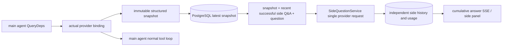

# ARTEX `/btw`

Regular chats, task MainAgents, and the current task's own Workers support independent side questions. Type `/btw question` in the main input box to submit; an empty `/btw` or the "Side questions" button opens the history. Desktop uses a resizable sidebar; mobile uses a Drawer.

Side answers are generated from the agent context snapshot at submission time and support streaming display, follow-ups, stop, and clear. Closing the panel, refreshing the page, or disconnecting SSE does not cancel the model request. Stop only affects the current side question; clear cancels the side question and deletes the side history while keeping the main context snapshot.

## Implementation Boundaries

Built on Go, norma v0.3.7, Next.js, and the existing Markdown / ResizablePanel / Drawer / AlertDialog components; norma source was not modified and no dependencies were added for side questions. Planner, Workers inherited from other tasks, and tool-type subtask promotion are out of scope.

- `capture.go` only marks main-loop requests in `Options.Deps.CallModel / CallModelSync`. The provider decorator sits inside the concrete model, after route-pool outer selection, so it records the actually selected model; compaction and summary requests do not overwrite the snapshot.
- Snapshots are published at request start, complete model replies, and run terminal states. Half-generated replies are not published; tool calls stay paired via norma's `MessagesForAPI`, and tool results enter the snapshot at the next main model request or run terminal state. A stream abort keeps the last valid boundary.
- Snapshots preserve structured messages, system prompts, tool definitions, and generation parameters via JSON deep copy. Model inference holds no snapshot lock or database transaction.
- `SideQuestionService` calls the concrete provider; it generates a side summary first when necessary, and the final answer may retry once after reduction only when the first attempt hits context overflow before any text/tool-call output. It creates no agent session and does not hook into the tool executor, main transcript, activity stream, or task graph, nor the task model-failover chain. Answers keep tool definitions only for compatibility with existing structured tool context; summary requests provide no tools. Newly returned tool calls have no execution path.
- One running request per parent session, at most four per service process, 120-second timeout per request. Side questions use an independent cancellation context under the service lifecycle.
- Side requests keep the model configuration reference and a non-sensitive identity digest; credentials are taken from the current configuration at request time. If the configuration is deleted, or identity fields such as model, protocol, or address change, the main agent must run first to update the snapshot. Tests do not change the product default model.

## Persistence and Recovery

`db/schema.sql` automatically creates `side_question_sessions` and `side_question_requests`. The former stores the parent resource, latest snapshot, run number, version, and cleanup generation; the latter stores the question, cumulative answer, status, model, snapshot time, usage, event sequence, and pagination ordinal.

The parent session key uses the conversation ID, or task ID + exploration ID + intent ID. Workers do not use reusable execution-slot naming.

Snapshots are merged and written per parent session, flushed every 250 ms; the database compares `(run_id, version)` to prevent older versions from overwriting. The selected snapshot is saved again before a side submission. After a successful save, the large in-memory snapshot is released; on failure, the pending write version is kept. Cumulative answer content is written at most every 250 ms as stream events arrive, saved immediately at terminal state, with bounded retries on database errors.

On service start, leftover `running` requests are marked `interrupted`, keeping the persisted partial answer and usage without automatically replaying the request. The most recently saved context can be used directly for the next question. When an old session has no snapshot, the main agent must run first; context is not rebuilt from UI activity records.

Clearing increments the cleanup generation and deletes requests; conditional updates prevent late callbacks from writing back. Physical parent-resource deletion relies on foreign-key cascades; Worker logical deletion deletes side data in the same transaction and rejects subsequent late snapshots. Task archiving first blocks new requests, waits for the main flow to stop, then cancels and waits for side persistence; the archive format is v3 and remains compatible with v1/v2 archives without side tables.

History is fully preserved, returning at most 20 entries per page by ordinal cursor. Model requests replay at most the 20 most recent successful Q&A exchanges verbatim, with replay volume also bounded by the token budget; older exchanges are maintained in a separate rolling summary. When the main context exceeds budget, only the older part of the side copy is summarized, keeping recent structured tool calls and results. Summaries, preparation progress, and usage all fall under the side question's concurrency, cancellation, and 120-second timeout limits. See [Context Budget and Open-Source References](CONTEXT_BUDGET.md) for details.

## HTTP Contract

The following paths serve as `{parent}`, using existing authentication and resource validation:

- `/api/conversations/{id}`
- `/api/tasks/{id}/chat`
- `/api/tasks/{id}/intents/{iid}`

| Request | Response and behavior |
| --- | --- |
| `GET {parent}/side-questions?before={ordinal}` | `items` ordered newest to oldest, independent `current` running status, `snapshot` metadata, `next_cursor`; cursor 0 means latest page / no next page |
| `POST {parent}/side-questions` | JSON `{ "question": "…", "client_request_id": "UUID" }`; a new request returns 202 with the request object; the same ID and question return the existing object with 200 |
| `DELETE {parent}/side-questions` | Cancel and clear the current parent session's side Q&A |
| `GET /api/side-questions/{requestID}/events` | `snapshot` SSE events; `id` is an increasing sequence number, `data` is the full cumulative request object; `cleared` is sent on clear |
| `POST /api/side-questions/{requestID}/cancel` | Explicit cancel; the terminal state can be read from history or SSE |

Questions are capped at 4000 characters. No snapshot, model configuration change, a busy parent session, or an idempotency-ID conflict returns 409; the global concurrency limit returns 429. Every SSE connection first sends the cumulative status, not relying on text fragments the client received earlier. The frontend merges by request ID + sequence number and discards old callbacks when switching parent sessions or clearing.

## Validation and References

Automated checks, real model usage, and known limitations: see [VALIDATION.md](VALIDATION.md).

Independent request reference: [Grok CLI side-question.ts (pinned commit)](https://github.com/superagent-ai/grok-cli/blob/fb97af83f06dca873281d60168430f06c8de6324/src/utils/side-question.ts); run isolation reference: [OpenCode (pinned commit)](https://github.com/anomalyco/opencode/tree/b3f1a96c6dd7adeb28b36dd11add1998fc84d67b). ARTEX's context uses norma's structured messages, not text spliced from frontend logs.
