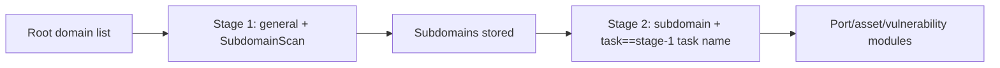

---

## name: scopesentry-mcp
description: Manage the security scanning platform (projects, tasks, templates, assets, nodes) through the ScopeSentry MCP. Use when the user mentions ScopeSentry, MCP, API Key, scan tasks, or asset queries.

# ScopeSentry MCP usage guide

For users with a **deployed ScopeSentry instance**. Connect to the platform through Cursor (or another MCP client); no local source code needed.

## 1. Preparation

### 1.1 Confirm the service is reachable

- Default web interface: `http://<host>`
- MCP endpoint: `http://<host>/mcp` (if a reverse proxy or frontend proxy sits in front, use the actual `/mcp` address)

### 1.2 Create an API Key

1. Log in to the ScopeSentry web interface in a browser
2. Go to the **API Key** management page to create a key (or create one through the admin-provided endpoint)
3. Save the returned `ssk_...` string (**shown only once**)

### 1.3 Configure the Cursor MCP

Cursor → Settings → MCP → add a server:

```json
{
  "mcpServers": {
    "scopesentry": {
      "url": "http://<your-host>:8082/mcp",
      "headers": {
        "X-API-Key": "ssk_your-key"
      }
    }
  }
}
```

You can also use: `Authorization: Bearer ssk_your-key`

After configuring, restart the MCP or reload Cursor and confirm that `list_projects`, `list_assets`, etc. appear in the tool list.

---

## 2. Tool overview


| Tool                      | Purpose                |
| ---------------------- | ----------------- |
| `list_projects`        | Project tree grouped by tag (with project IDs) |
| `list_projects_data`   | Paginated project list, searchable by name     |
| `get_project`          | Project details              |
| `create_project`       | Create a project              |
| `list_tasks`           | Scan task list            |
| `get_task`             | Task details              |
| `list_scan_templates`  | Scan template list            |
| `get_scan_template`    | Template details              |
| `list_plugin_modules`  | Scan pipeline module names          |
| `list_plugins`         | Available plugins (with hash, default parameters) |
| `create_scan_template` | Create a scan template            |
| `create_scan_task`     | Create a scan task            |
| `list_assets`          | Query all kinds of assets (paginated list)       |
| `count_assets`         | Count assets (`/api/assets/common/total`) |
| `get_asset_detail`     | Asset or vulnerability details           |
| `add_asset_tag`        | Add a tag to an asset           |
| `list_nodes`           | Scan node list            |


Refer to each tool's MCP description (schema) for parameters; `list_assets` / `count_assets` share the same search and filter syntax — read the `list_assets` description before querying assets.

Use `count_assets` (it maps to the Web paginated-total endpoint) when you need to know "how many in total"; there is no need to page through `list_assets` just to count.

---

## 3. Common workflows

### 3.1 Query assets by project

When the user or context **already has a project constraint**, include `filter.project` to narrow the scope and avoid slow responses from too much cross-project data. Without an explicit project, the project filter is not mandatory.

1. Use `list_projects` or `list_projects_data` to get the target project's **ObjectID** (`id` / `children[].value`)
2. Pass `filter.project` to `list_assets` (**it must be the ID, not the project's display name**)

```json
{
  "asset_type": "asset",
  "pageIndex": 1,
  "pageSize": 20,
  "search": "domain=^example.com",
  "filter": {
    "project": ["<project-ObjectID>"]
  }
}
```

### 3.2 Create a scan task

1. `list_nodes` to get online node names
2. `list_scan_templates` or `create_scan_template` to get the template **ObjectID**
3. `create_scan_task`: `name` and `node` are required; `template` takes the template ID (not the template name)

**Target source `targetSource` (same as the Web UI):**

| targetSource | Description | Required parameters |
| --- | --- | --- |
| `general` | Targets entered directly | `target` |
| `project` | Read targets from a project | `project` (array of project ObjectIDs) |
| `asset` | Search the web asset store | `search`; optional `project`, `filter`, `targetNumber` |
| `RootDomain` | Search the root domain store | `search`; optional `project`, `filter`, `targetNumber` |
| `subdomain` | Search the subdomain store | `search`; optional `project`, `filter`, `targetNumber` |
| `UrlScan` | Search URL scan results | `search`; optional `project`, `filter`, `targetNumber` |
| `*Source` (e.g. `subdomainSource`) | Created from the asset page via "select/search" | Use `search` when `targetTp=search`; use `targetIds` when `targetTp=select` |

**Example — scan root domains directly:**

```json
{
  "name": "example-subdomain-collection",
  "node": ["node-1"],
  "template": "<template-ObjectID>",
  "targetSource": "general",
  "target": "example.com\nfoo.com",
  "project": ["<project-ObjectID>"]
}
```

**Example — continue scanning from the subdomain store (filtered by the previous task name):**

```json
{
  "name": "example-port-and-vulnerability",
  "node": ["node-1"],
  "template": "<follow-up-module-template-ObjectID>",
  "targetSource": "subdomain",
  "search": "task==\"example-subdomain-collection\"",
  "project": ["<project-ObjectID>"]
}
```

### 3.3 Full information gathering for root domains (two stages recommended)

When the input is a **root domain** and **full information gathering** is required, run two scans instead of the whole pipeline in one go.

**Why:** distributed tasks are dispatched per **single target**. When a root domain is the target, the node it lands on keeps running the follow-up modules for every subdomain discovered on that node, which easily causes uneven load, slowness, and errors.

**Best practice:**

1. **Stage 1 — subdomain collection only**
   - `targetSource`: `general`
   - `target`: all root domains (multiple lines)
   - Template: enable only `SubdomainScan` and `SubdomainSecurity` (subdomain scanning + subdomain takeover)
   - Use `get_task` to wait for the task to finish

2. **Stage 2 — follow-up modules**
   - `targetSource`: `subdomain`
   - `search`: `task=="<stage-1-task-name>"` (exact match on the task name)
   - Optional `project` to narrow the scope
   - Template: port scanning, asset mapping, vulnerability scanning, etc. (SubdomainScan can be omitted)
   - Subdomains are dispatched to nodes as independent targets, with better parallel efficiency

You can also filter by task name on the "Subdomain" asset page in the web UI and use "Create task from subdomains"; the effect is the same.



### 3.4 Create a scan template

1. `list_plugin_modules` → module name list
2. `list_plugins` (filterable by `module`) → each plugin's `hash` and default `parameter`
3. `create_scan_template`: use `modules` to specify "module → array of plugin hashes"

---

## 4. Asset queries (`list_assets` / `count_assets`)

`count_assets` takes the same `asset_type`, `search`, and `filter` as `list_assets`, returns `{ "total": N }`, and maps to the web endpoint `/api/assets/common/total`.

```json
{
  "asset_type": "subdomain",
  "search": "task==\"some-task-name\"",
  "filter": {"project": ["<project-ObjectID>"]}
}
```

**Performance tips (common to `list_assets` / `count_assets`):** with a project constraint, prefer `filter.project` to narrow the scope; in `search`, prefer `==` equality or `^` prefix matching on indexed fields (see [4.3](#43-search-expressions)) and avoid large-scale `=` fuzzy queries that slow responses. Without project context, the project filter is not mandatory.

See the [4.4](#44-filter-exact-filtering) table for types that support `filter.project`.

### 4.1 Asset types `asset_type`

`asset`, `RootDomain`, `subdomain`, `app`, `mp`, `UrlScan`, `SensitiveResult`, `DirScanResult`, `crawler`, `vulnerability`, `PageMonitoring`, `IPAsset`, `SubdomainTakerResult`

Alias examples: `web`→asset, `vuln`→vulnerability, `ip`→IPAsset, `url`→UrlScan

### 4.2 Parameters


| Parameter                      | Description                                      |
| ------------------------ | --------------------------------------- |
| `pageIndex` / `pageSize` | Pagination, defaults 1 / 20 |
| `search`                 | Search expression (see the next section) |
| `filter`                 | Exact-filter JSON (see the next section) |
| `sort`                   | Only UrlScan and DirScanResult support sorting by `length` |
| `sid`                    | SensitiveResult only: sensitive rule name |


`search` and `filter` **can be used together**.

### 4.3 search expressions

A custom DSL (**not SQL**):


| Operator | Meaning | Index | Example |
| ---- | ---- | ---- | --------------------------- |
| `=`  | Fuzzy match (regex) | No index | `domain=example` |
| `==` | Exact match (equality) | **Uses index** | `port==443` |
| `!=` | Exclude | — | `port!="80"` |
| `&&` | AND | — | `domain==example.com && port==443` |
| `||` | OR | — | `title=admin || body=login` |


**Indexes and operators:** fields such as `domain`, `ip`, `port`, and `title` are indexed, but only **`==` equality** or **prefix matching where the value starts with `^`** (e.g. `domain=^example.com`) uses the index; **`=` becomes a regex fuzzy match and cannot use the index**, which gets slow on large datasets.

**search fields common to all types:** `tag`, `task` (task name), `rootDomain`

**project cannot go in search** (invalid, or errors when combined with `&&`). Filter projects with `filter.project`.

**Common search fields per type:**


| asset_type           | Fields |
| -------------------- | ----------------------------------------------------------------------------------- |
| asset                | domain, ip, port, service, app, title, statuscode, icon, banner, type, body, header |
| RootDomain           | domain, icp, company                                                                |
| subdomain            | domain, ip, type, value                                                             |
| app                  | name, icp, company, category, description, url, apk                                 |
| mp                   | name, icp, company, category, description, url                                      |
| UrlScan              | url, input, source, resultId, type                                                  |
| SensitiveResult      | url, sname, body, info, md5                                                         |
| DirScanResult        | url, statuscode, redirect, length                                                   |
| vulnerability        | url, vulname, matched, request, response, level                                     |
| crawler              | url, method, body, resultId                                                         |
| PageMonitoring       | url, hash, diff, response                                                           |
| IPAsset              | ip, domain, port, service, webServer, app                                           |
| SubdomainTakerResult | domain, value, type, response                                                       |


**search examples:**

- `domain==www.example.com && port==443` (equality, uses the index)
- `domain=^example.com` (prefix match, uses the index)
- `ip==192.168.1.1`
- `task=="some-task-name"`
- `level==high` (vulnerability)
- `statuscode==200` (DirScanResult)

Use `=` only when you need fuzzy containment, e.g. `title=admin` (no index; best combined with a project or similar constraint to narrow the scope).

### 4.4 filter exact filtering

A JSON object: multiple values for the same key mean **OR**; different keys mean **AND**.

**Prefer `project` when you have one:** if the user or context already names a project and the asset_type supports `project`, include it to narrow the scope; without project information it is not mandatory.


| filter key   | Meaning | Value notes |
| ------------ | -------- | -------------------------------------------------------- |
| `project`    | Owning project | **ObjectID**, obtained via `list_projects` / `list_projects_data` |
| `task`       | Source task | **Task name**, the `name` from `list_tasks` |
| `port`       | Port | e.g. `"443"` |
| `service`    | Service/protocol | e.g. `"https"` |
| `app`        | Application fingerprint | e.g. `"Nginx"` |
| `icon`       | Icon hash | |
| `statuscode` | HTTP status code | Mainly for asset |
| `status`     | Status | UrlScan/DirScan HTTP code; vulnerability/sensitive-info handling status |
| `level`      | Vulnerability severity | critical / high / medium / low / info |
| `type`       | Type | e.g. subdomain record types A, CNAME |
| `color`      | Sensitive rule color | SensitiveResult |
| `sname`      | Sensitive rule name | SensitiveResult |
| `tags`       | Tags | |


**Available filter keys per type:**


| asset_type                            | filter key                                                      |
| ------------------------------------- | --------------------------------------------------------------- |
| asset                                 | project, port, service, app, icon, statuscode, type, task, tags |
| RootDomain                            | project, tags                                                   |
| subdomain                             | project, type, task, tags                                       |
| app / mp                              | project, tags                                                   |
| UrlScan                               | status, tags                                                    |
| DirScanResult                         | status, tags                                                    |
| SensitiveResult                       | status, color, sname, tags                                      |
| crawler                               | project, task, tags                                             |
| vulnerability                         | project, level, status, task, tags                              |
| PageMonitoring / SubdomainTakerResult | tags                                                            |
| IPAsset                               | project, port, service, app                                     |


**filter example:**

```json
{"project": ["<project-ObjectID>"], "port": ["443"]}
```

**Combined query example:**

```json
{
  "asset_type": "asset",
  "search": "domain=^baidu && port==443",
  "filter": {"project": ["<project-ObjectID>"]},
  "pageIndex": 1,
  "pageSize": 10
}
```

**Notes:**

- With a project constraint, include `filter.project` (when supported); without project context it is optional
- Do not put the project display name in `filter.project`
- Use `==` for known values and `^` for prefixes; avoid heavy `=` fuzzy matching on large tables
- UrlScan HTTP status goes in `filter.status`; DirScanResult can use `statuscode==200` in search
- SensitiveResult by rule name: use `sname=rule-name` in `search`, or `filter.sname`

### 4.5 Sorting (sort)

Only **UrlScan** and **DirScanResult** support it:

```json
{"length": "ascending"}
```

Other types ignore `sort` and use the default time-based ordering.

---

## 5. Scan template module names

`TargetHandler`, `SubdomainScan`, `SubdomainSecurity`, `PortScanPreparation`, `PortScan`, `PortFingerprint`, `AssetMapping`, `AssetHandle`, `URLScan`, `WebCrawler`, `URLSecurity`, `DirScan`, `VulnerabilityScan`, `PassiveScan`

---

## 6. Troubleshooting


| Symptom        | Fix                                                 |
| --------- | -------------------------------------------------- |
| No MCP tools | Check the URL, the API Key, and whether ScopeSentry is running |
| 401 / 403 | Recreate or replace the API Key |
| Assets not found | Confirm `filter.project` is an ObjectID; do not put project in search |
| Template/task creation failed | `template` must be a template ObjectID; `node` takes an online node name |
| Queries slow/stuck | Add `filter.project` when you have a project; in search use `==` or `^` prefixes on indexed fields, use `=` sparingly; reduce `pageSize` |


---

